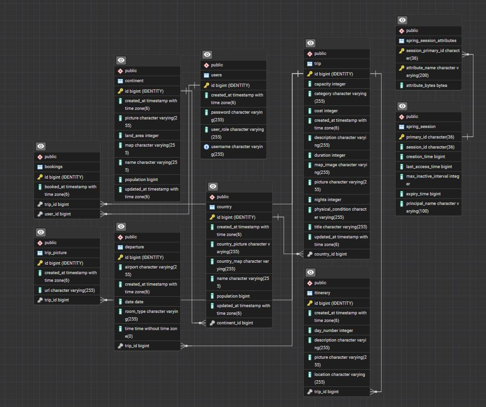

# Travel Agency Website

A backend web application for a travel agency (Ταξιδιωτικό Πρακτορείο) where clients can browse trips around the world, book them, and cancel them.

## Project Idea and Inspiration

The goal of this project was to build a simple API while learning user authentication through Spring Boot's JDBC session management and user details. As someone who loves travelling and geography, I chose to build a travel app instead of a geography quiz app. Inspired by popular travel websites and apps, I wanted to see what I could create while trying out new technologies and getting a better grasp of the Spring Boot framework and PostgreSQL database management.

## Prerequisites

To run the project locally, you will need:

- Java JDK 25
- Spring Boot 4.1.2
- PostgreSQL 17.10
- Node.js v22.10

## Running the Backend

> **Note:** This is a monorepo — the Maven `pom.xml` lives inside `/server`, not at the repository root. If you open the root directory, it will not be detected as a Spring Boot project and the run button will not appear.

### Opening the Backend in IntelliJ

1. `File` → `Open...` → select `server/pom.xml` → **"Open as Project"**
2. `File` → `Project Structure` → `Project` → set **SDK** to JDK 25 (download via `SDKs` → `+` → `Download JDK` → `25` if needed) and **Language level** to 25.

### Running via Terminal

```shell
cd server
mvnw.cmd spring-boot:run
```

# API Endpoints

| Method | URL | Description |
|--------|-----|-------------|
|POST    |/api/v1/register/  |Register a new user into the database|
|POST    |/api/v1/login/  |Login into account and start session|
|POST    |/api/v1/logout/  |Stop session and destroy session data|
|POST    |/api/v1/booking  |Create a new booking|
|DELETE    |/api/v1/booking/my-bookings/{id}  |Delete a users booking|
|GET    |/api/v1/booking/my-bookings  |Get a users bookings|
|GET    |/api/v1/continent  |Get all continents from the database|
|GET    |/api/v1/country/{continentId}  |Get all countries from the continent with id|
|GET    |/api/v1/trip/{countryId}  |Get all trips from the country with id|

### Interactive API Documentation
Fully integrated **Swagger UI** provides a live, interactive reference for every endpoint — including request payloads, response schemas, status codes, and authentication requirements. Developers can explore and test the API directly from the browser, making integration faster and more transparent.
 **Access:** `/swagger-ui.html` (or `/swagger-ui/index.html` depending on your Springdoc setup)

### Robust Security with Spring Security
Built on **Spring Security**, the API enforces authentication and authorization at every layer. It supports secure credential handling, role-based access control, and protection against common vulnerabilities such as CSRF and session fixation — ensuring only authorized users can access protected resources.

### Intelligent Rate Limiting
A configurable **rate limiter** protects the API from abuse and traffic spikes by controlling how many requests a client can make within a given time window. This safeguards service availability, prevents denial-of-service attempts, and ensures fair resource usage across all consumers.

---
# ERD

